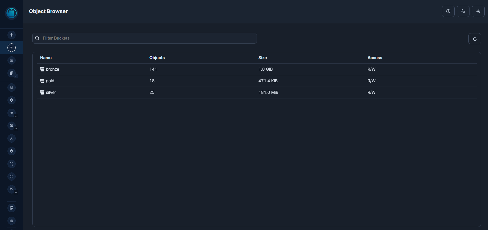
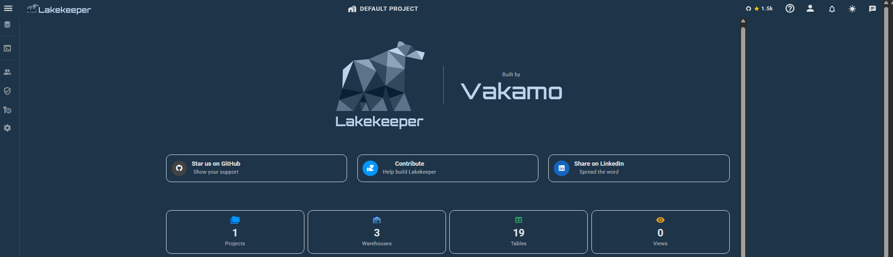
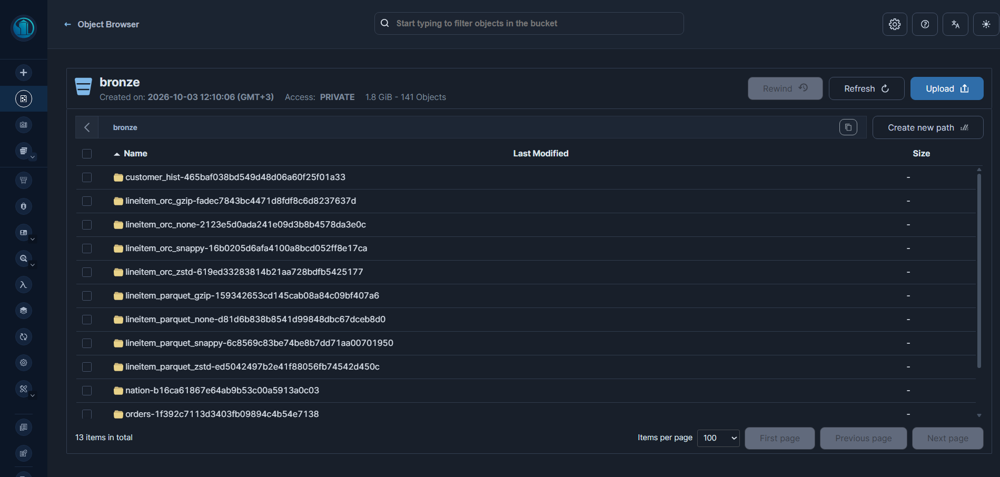
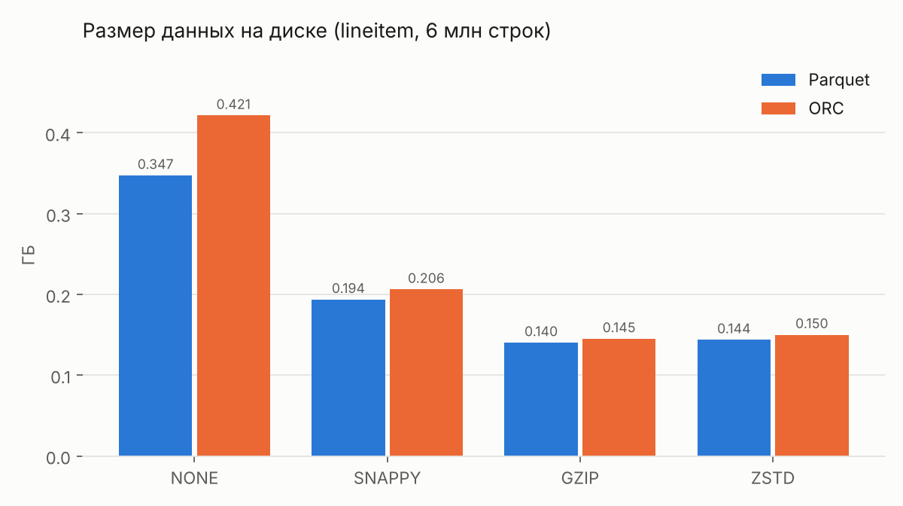
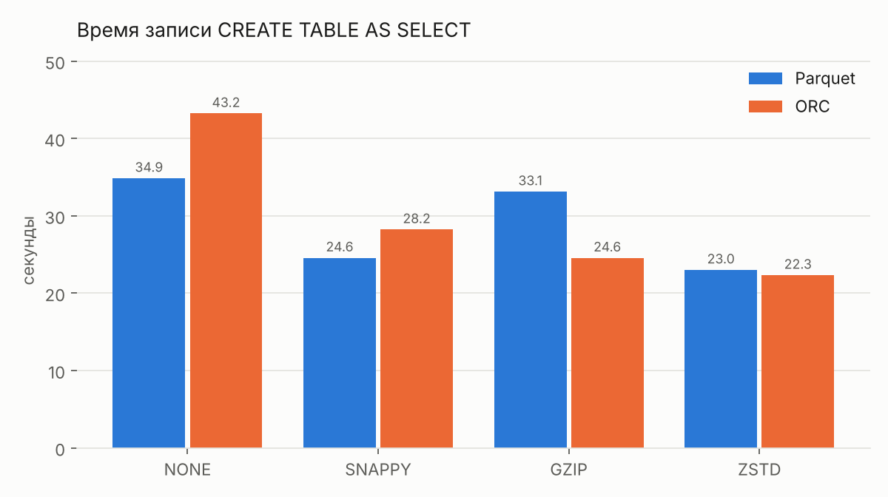
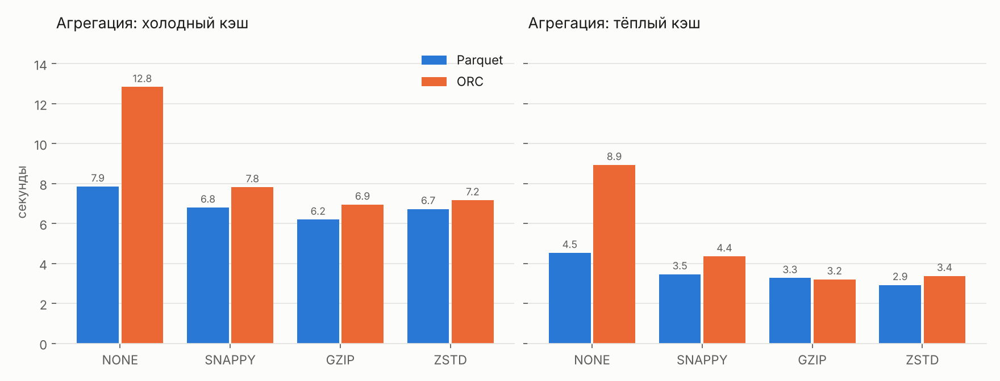
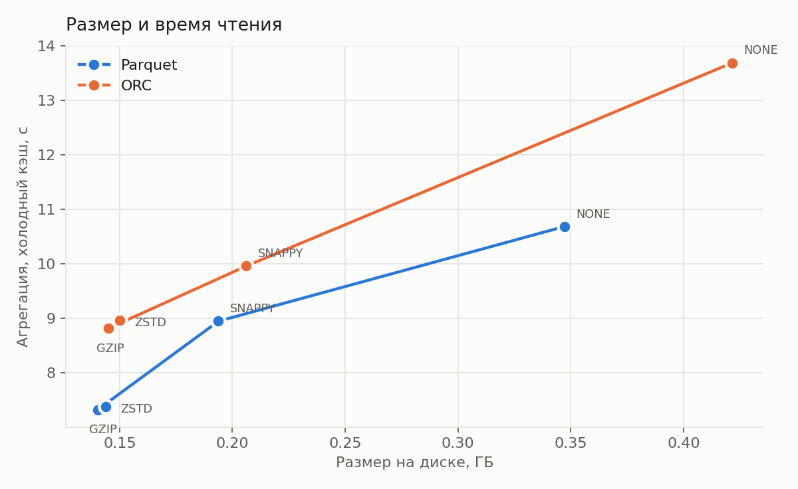

# Практическая работа №1. Локальный Lakehouse, ELT и сравнение форматов и кодеков

В работе поднят локальный Lakehouse (MinIO + Lakekeeper + Trino), на данных TPC-H по схеме ELT построен медальон Bronze / Silver / Gold, и сравнены 2 формата (Parquet, ORC) с 4 кодеками (NONE, SNAPPY, GZIP, ZSTD): сколько места занимают, как быстро пишутся и как быстро читаются.

Всё запускается одной командой `run.cmd`, по шагам расписано в [ШАГИ.md](ШАГИ.md).

---

## 1. Стенд

Lakehouse складывается из трёх частей: дешёвое объектное хранилище, табличный формат с ACID и метаданными и отдельный движок для запросов. У меня это MinIO, Apache Iceberg и Trino. Iceberg-таблицами управляет каталог Lakekeeper, свои метаданные он хранит в Postgres.

```
SQL / Python  ->  Trino  ->  Lakekeeper (+ Postgres)  ->  MinIO (бакеты bronze, silver, gold)
```

Образы: `pgsty/silo:latest` (MinIO), `postgres:17`, `quay.io/lakekeeper/catalog:latest-main`, `trinodb/trino:476`.

Главное, чем это отличается от классического DWH вроде Greenplum: хранение и вычисления разделены. В MPP-хранилище данные лежат на дисках сегментов во внутреннем формате, и без самой СУБД их не прочитать. Здесь файлы открытые. Если удалить Trino, ничего не пропадёт, данные останутся в MinIO, а метаданные в Postgres. Это даже проверилось на практике, когда контейнер Trino сломался посреди бенчмарка (раздел 4).

Как Trino находит таблицу: спрашивает у Lakekeeper, где лежит текущий `metadata.json`, а дальше сам идёт по дереву метаданных Iceberg. metadata.json -> manifest list -> манифесты -> файлы данных. В манифестах есть статистика по колонкам (min/max), по ней можно не читать лишние файлы.

При записи Trino кладёт новые файлы и новый снапшот, а каталог атомарно переключает указатель на новый metadata.json (compare-and-swap). Если кто-то успел закоммитить раньше, коммит отклоняется, и его надо повторить. Так и получается ACID поверх обычных файлов в S3. В Hive-таблицах этого не было, там состав таблицы определялся просто листингом папки. А "голый" Data Lake без каталога со временем превращается в болото.

В Trino 4 каталога: `bronze`, `silver`, `gold` (каждый смотрит в свой warehouse в Lakekeeper) и `tpch`, встроенный генератор, из него берутся данные.

### Бакеты и warehouse

На каждый слой медальона свой бакет в MinIO и свой warehouse в Lakekeeper.



| Бакет | Объектов | Размер | Что лежит |
|---|---|---|---|
| `bronze` | 141 | 1.8 GiB | 8 вариантов `lineitem` для бенчмарка + сырые справочники и заказы |
| `silver` | 25 | 181.0 MiB | очищенные продажи на 6 млн строк + справочник клиентов |
| `gold` | 18 | 471.4 KiB | три витрины, всего 10 074 строки |

Чем дальше слой, тем меньше объём. В Bronze 8 копий lineitem и сырьё, в Silver одна очищенная копия, в Gold только агрегаты.

В Lakekeeper 3 warehouse и 19 таблиц: в Bronze 8 вариантов бенчмарка и 5 сырых таблиц, в Silver и Gold по 3.



### Почему так, а не иначе

- Три отдельных warehouse и бакета вместо одного. Вообще слои медальона логические, их можно сделать просто схемами в одном хранилище. Но если разнести физически, права (RBAC) и политики хранения настраиваются для каждого слоя отдельно, и из Gold нельзя случайно записать в Bronze.
- Iceberg, а не Delta Lake. У Delta журнал `_delta_log` лежит внутри таблицы, и формат больше заточен под Spark. Iceberg с внешним REST-каталогом одинаково работает с Trino, Spark и Flink.
- `pgsty/silo` вместо `minio/minio`. Официальные образы MinIO убрали с Docker Hub, `quay.io/minio/minio` отвечает 401, а AIStor требует лицензию. Silo это форк с тем же API.
- `host.docker.internal:9000` вместо `localhost`, потому что Lakekeeper и Trino сидят в контейнерах, и `localhost` для них это они сами.
- В Trino монтируется вся папка `catalog/`. Чтобы добавить каталог, хватает положить новый `.properties` и сделать `docker restart trino`.

---

## 2. Данные

Отрасль - оптовая торговля, набор TPC-H из встроенного коннектора Trino. Коннектор ничего не хранит, а генерирует строки на лету, причём детерминированно, так что на любой машине получаются одни и те же данные. В Iceberg они попадают через `CREATE TABLE ... AS SELECT`.

Масштаб `sf1`: 6 001 215 строк в `lineitem`, около 0.7 ГБ сырых данных. Больше ноутбук не тянет: 16 ГБ RAM, ~50 ГБ свободного места, а Trino в Docker Desktop получает примерно половину памяти. На `sf10` восемь таблиц заняли бы ~40 ГБ, и запросы падали бы с `Query exceeded memory`. На `sf1` все 8 вариантов весят 1.75 ГБ, прогон идёт минут 25. Для сравнения кодеков важны соотношения, а они от масштаба почти не зависят. Если надо, масштаб меняется флагом `python 02_benchmark.py --sf 10`.

Для бенчмарка взята `lineitem`, потому что в ней 16 колонок разных типов: целые, дробные суммы, проценты, даты, короткие строки. Кодеки на разных типах ведут себя по-разному, на таблице из одних чисел картина была бы однобокой.

Нагрузка тут типичный OLAP: прочитать несколько колонок по миллионам строк и посчитать агрегаты. Точечных вставок и обновлений по ключу, как в OLTP, нет, поэтому и форматы колоночные.

---

## 3. Медальон

Всё сделано по ELT. Сырьё сначала грузится в Bronze как есть, а очистка и преобразования идут уже внутри Lakehouse, SQL-запросами в том же Trino. Отдельного ETL-сервера нет, данные преобразуются там же, где лежат. В Bronze данные остаются со схемой источника (schema-on-read), а строгие типы и правила появляются только в Silver. Если сравнивать с классикой, Bronze / Silver / Gold примерно соответствуют ODS / DDS / DM.

### Bronze

`sql/01_bronze.sql` + `02_benchmark.py`

| Таблица | Строк | Зачем |
|---|---|---|
| `bronze.bench.lineitem_<формат>_<кодек>` x 8 | 6 001 215 каждая | сырая загрузка в 8 вариантах, на ней бенчмарк |
| `bronze.raw.orders` | 1 500 000 | заказы |
| `bronze.raw.customer_hist` | 161 943 | клиенты, две загрузки |
| `bronze.raw.part` | 200 000 | товары |
| `bronze.raw.nation` / `region` | 25 / 5 | география |

Bronze это источник истины, поэтому бизнес-логики тут нет. Данные ложатся как пришли, добавлено только служебное поле `loaded_at` с датой загрузки. Таблицы только дополняются: вторая выгрузка клиентов (11 943 клиента с новым сегментом и балансом) дописывается к первой через `INSERT`, а не перезаписывает её. Если в Silver окажется ошибка в правилах, всё пересчитывается из Bronze без потерь. И на двух загрузках клиентов потом хорошо видны снапшоты Iceberg (time travel, в конце раздела).

8 вариантов `lineitem` тоже лежат в Bronze, в схеме `bronze.bench`. В задании сказано загрузить сырые данные в двух форматах с разными кодеками, а это и есть загрузка в Bronze. Дальше в Silver идёт `parquet_zstd`, он выиграл бенчмарк (почему, в разделе 7).

В бакете `bronze` 13 папок, по одной на таблицу. Iceberg дописывает к имени папки uuid (`iceberg.unique-table-location=true`), поэтому когда бенчмарк пересоздаёт таблицу, новые файлы не путаются со старыми.



### Silver

`sql/03_silver.sql`

В Silver данные чистятся, приводятся к нормальным типам и связываются между собой, чтобы все витрины дальше брали одну и ту же согласованную версию.

Сначала проверка качества (`silver.core.dq_report`). Она идёт до фильтрации, прямо по сырому `lineitem`: количество и цена больше нуля, скидка от 0 до 1, отгрузка не раньше заказа, коды `returnflag` из допустимых, у каждой строки есть заказ. Это quality gate между Bronze и Silver.

| rows_total | bad_quantity | bad_price | bad_discount | bad_shipdate | bad_returnflag | orphan_orderkey |
|---|---|---|---|---|---|---|
| 6 001 215 | 0 | 0 | 0 | 0 | 0 | 0 |

Брака ноль, но TPC-H синтетический, у него данные всегда согласованные. Поэтому `silver_rows` = `rows_total` = 6 001 215. На выгрузке из живой учётной системы эти счётчики были бы ненулевыми.

Потом типы и нормализация. Деньги (`extendedprice`) из double переведены в `decimal(12,2)`, потому что double при `sum()` по миллионам строк копит ошибку округления. Однобуквенные коды заменены на слова: `returnflag` A / N / R стал `accepted` / `none` / `returned`, `linestatus` O / F стал `open` / `fulfilled`, так витрину можно читать без расшифровки. `shipmode` прогнан через `upper(trim(...))`, чтобы разный регистр и пробелы в источнике ничего не ломали.

Тип денег поменян в новой таблице Silver, а не через `ALTER TABLE` в Bronze. Bronze по смыслу трогать нельзя, да и Iceberg такое не разрешит: эволюция схемы допускает только безопасные расширения типа (int -> bigint, float -> double, decimal с большей точностью), а double -> decimal к ним не относится.

Дальше обогащение. К каждой продаже добавлены суммы (`net_amount` это цена минус скидка, `net_with_tax`, `discount_amount`), сроки доставки (`delivery_days`, `delay_vs_commit`, флаг `is_late`), поля из соседних таблиц (`custkey` и `orderdate` из заказов, `brand` и `part_type` из товаров) и `order_month` / `order_year`, чтобы витрины не считали даты на каждом запросе. Заказы присоединяются через INNER JOIN, так что продажи без заказа отсеялись бы здесь.

И последнее, справочник клиентов (`silver.core.dim_customer`). Клиенты соединены со странами и регионами, сегмент приведён к одному регистру, баланс к decimal. Клиентов загружали дважды, поэтому у тех, кому вторая загрузка поменяла сегмент, в справочнике две строки, старая и новая. Новая помечена флагом `is_current`, по нему витрины берут текущий сегмент.

| dim_rows | current_rows | historical_rows |
|---|---|---|
| 161 943 | 150 000 | 11 943 |

Цифры сходятся: 150 000 клиентов, у каждого одна актуальная строка, плюс 11 943 старые у тех, кто сменил сегмент. Всего 161 943, ровно как в `bronze.raw.customer_hist`.

### Gold

`sql/04_gold.sql`

Три витрины, каждая отвечает на свой вопрос, все джойны уже сделаны:

- `revenue_by_region_segment_month` (10 000 строк): как распределяется выручка по регионам, сегментам клиентов и месяцам;
- `shipping_performance` (49 строк): какой способ доставки чаще опаздывает и сколько выручки на этих заказах;
- `returns_by_brand` (25 строк): какие бренды чаще возвращают.

В витрину выручки клиент берётся в текущей версии (`JOIN ... AND d.is_current`), так что продажи прошлых лет показываются под тем сегментом, где клиент сейчас.

```
   region    | market_segment |      net
-------------+----------------+----------------
 EUROPE      | HOUSEHOLD      | 12364317388.86
 AMERICA     | HOUSEHOLD      | 12306616831.92
 MIDDLE EAST | HOUSEHOLD      | 12246030338.42
```

`HOUSEHOLD` с большим отрывом первый во всех пяти регионах: вторая загрузка перевела в этот сегмент 11 943 клиента (см. `01_bronze.sql`), а витрина берёт текущий сегмент клиента.

Time travel. Iceberg хранит историю версий таблицы, у `bronze.raw.customer_hist` два снапшота, по одному на каждую загрузку:

```
     snapshot_id     |        committed_at         | operation
---------------------+-----------------------------+-----------
 4009209825564294064 | 2026-10-04 11:33:35.204 UTC | append
 4406925853943647327 | 2026-10-04 11:33:36.449 UTC | append
```

Таблицу до второй загрузки можно прочитать так:
`SELECT * FROM bronze.raw.customer_hist FOR VERSION AS OF 4009209825564294064`. Никакой бэкап для этого не нужен, старые файлы просто лежат в хранилище, пока их не удалит snapshot expiry.

---

## 4. Как мерилось

Все замеры делает `02_benchmark.py` за один прогон.

Конфигурация (из `/v1/status` Trino, скрин `docs/08_trino.png`): Trino v476, один узел, heap 5.91 ГБ, пул запросов 4.13 ГБ, 16 ядер. Хост Windows, Docker Desktop на WSL2, 16 ГБ RAM. Все 8 вариантов мерились на одной машине в одном прогоне, так что сравнивать их между собой можно, а вот абсолютные секунды на другом железе будут другие.

Что и как мерится:
- время записи: `time.perf_counter()` вокруг `CREATE TABLE AS SELECT`. Обязательно с `fetchall()`, без него клиент Trino возвращает управление раньше, чем запрос закончится;
- размер данных: `sum(file_size_in_bytes)` из системной таблицы `"<table>$files"`. В консоли MinIO файлы раскиданы по uuid-папкам, а тут сразу точная сумма по текущему снапшоту;
- число файлов: `count(*)` оттуда же;
- метаданные: `sum(length)` из `"<table>$manifests"`;
- чтение cold: запрос сразу после `docker restart trino lakehouse-minio`;
- чтение warm: тот же запрос второй раз подряд.

Кодек задаётся через свойство сессии:

```python
session_properties = {"bronze.compression_codec": codec}   # NONE | SNAPPY | GZIP | ZSTD
# CREATE TABLE ... WITH (format = 'PARQUET' | 'ORC')
```

В Iceberg-коннекторе Trino `compression_codec` есть только в сессии, если написать его в `WITH (...)`, будет ошибка `table property 'compression_codec' does not exist`. Поэтому скрипт после записи проверяет через `SHOW SESSION LIKE ...`, какой кодек реально стоял (колонка `codec_applied` в `results.csv`). Во всех 8 случаях совпал с нужным. Уровень ZSTD не менялся, стоит по умолчанию. При чтении кодек указывать не надо, он записан в метаданных файла, так что в одной таблице вообще могут лежать файлы с разными кодеками.

Запрос для чтения сделан по мотивам TPC-H Q1: группировка по `returnflag, linestatus` и суммы по `quantity`, `extendedprice`, `discount`, без `WHERE` и `ORDER BY`. Из 16 колонок он трогает 5, остальные 11 колоночный формат даже не читает с диска (column pruning). Фильтра нет, поэтому predicate pushdown по min/max не работает, и row groups (в ORC это stripes) по нужным колонкам читаются целиком. Получается чистая скорость чтения и распаковки.

### Ограничения

"Холодный" кэш на самом деле холодный только для Trino. `docker restart` сбрасывает кэши движка, но Docker Desktop работает внутри виртуалки WSL2, и её кэш файлов при перезапуске контейнера остаётся. Часть данных всё равно приходит из памяти, так что полученная разница cold/warm (1.4-2.6 раза) это нижняя граница, на чистом сервере она была бы больше.

Каждый вариант мерился один раз, без повторов. Разницу меньше ~0.5 с (например `parquet_gzip` 7.32 с и `parquet_zstd` 7.38 с) я считаю шумом.

И отдельная история с Docker. После восьмого `docker restart` контейнер Trino перестал запускаться (`exit 126`, `no such file or directory`), Docker Desktop испортил его файлы. При повторном прогоне всё повторилось, так что это особенность Docker Desktop на WSL2, а не случайность. Пришлось пересоздавать контейнер, для этого есть `finish.cmd`. Данные и каталог при этом не пострадали: файлы в MinIO, метаданные в Postgres, а Trino только считает. Разделение compute и storage проверилось вживую.

---

## 5. Результаты

Полные данные в [`results.csv`](results.csv).

| Вариант | Размер, ГБ | Экономия от none | Файлов | Метаданные, КБ | Запись, с | Чтение cold, с | Чтение warm, с | Ускорение от кэша |
|---|---|---|---|---|---|---|---|---|
| parquet_none | 0.347 | - | 8 | 9.4 | 34.5 | 10.68 | 4.71 | 2.27x |
| parquet_snappy | 0.194 | 44.2 % | 8 | 9.4 | 24.7 | 8.95 | 4.22 | 2.12x |
| parquet_gzip | **0.140** | **59.6 %** | 8 | 9.3 | 32.5 | **7.32** | **2.78** | 2.64x |
| parquet_zstd | 0.144 | 58.6 % | 8 | 9.3 | **22.6** | 7.38 | 3.00 | 2.46x |
| orc_none | 0.421 | -21.4 % | 8 | 8.8 | 33.3 | 13.68 | 9.60 | 1.43x |
| orc_snappy | 0.206 | 40.6 % | 8 | 8.8 | 25.8 | 9.96 | 5.36 | 1.86x |
| orc_gzip | 0.145 | 58.2 % | 8 | 8.8 | 32.3 | 8.82 | 3.56 | 2.48x |
| orc_zstd | 0.150 | 56.8 % | 8 | 8.7 | 27.2 | 8.96 | 5.03 | 1.78x |

Экономия считается от `parquet_none` (372 813 391 байт).

Бенчмарк гонялся два раза, в таблице второй прогон. Размеры, число файлов и манифесты совпали до долей процента (генератор детерминированный, расхождение в пределах десятков КБ). А время между прогонами плавало от долей процента до ~50 %, сильнее всего у тёплого чтения ORC. Поэтому выводы ниже строятся на том, что повторилось оба раза.









---

## 6. Анализ

### 6.1 Размер

Даже в режиме NONE данные не лежат "как есть". Parquet и ORC кодируют значения внутри колоночного чанка: словарь для колонок с малым числом разных значений (`returnflag`, `shipmode`), RLE для повторов подряд, bit-packing, чтобы на значение уходило минимум бит, и delta для упорядоченных колонок. Кодек работает отдельным слоем уже поверх этого. NONE отключает только кодек, кодирование остаётся.

Сильнее всех сжал GZIP: 0.140 ГБ, в 2.48 раза меньше несжатого Parquet. GZIP это DEFLATE, то есть LZ77 (повтор заменяется ссылкой "смещение, длина") плюс код Хаффмана (частым значениям короткие коды). Это кодек "на степень сжатия", за неё он платит процессором.

ZSTD отстал всего на 2.5 % (0.144 ГБ), зато записал на 30 % быстрее, 22.6 с против 32.5 с. У ZSTD к тому же настраивается уровень (1..22), его можно подвинуть ближе к GZIP.

SNAPPY сжал только в 1.79 раза. Он про скорость, а не про размер.

Формат на размер влияет меньше, чем кодек. Без кодека ORC больше Parquet на 21 %, это разница во внутреннем кодировании. С кодеком разрыв сокращается: SNAPPY 6.4 %, ZSTD 4.4 %, GZIP 3.4 %.

Про ORC обычно говорят, что он сжимает сильнее Parquet. На `lineitem` вышло наоборот: Parquet меньше на всех четырёх кодеках. Общие сравнения форматов это только ориентир, решает замер на своих данных.

### 6.2 Запись

Логично ожидать, что чем сильнее сжатие, тем дольше запись. Подтвердилось только наполовину. По времени записи порядок такой: `parquet_zstd` 22.6 с, `parquet_snappy` 24.7, `orc_snappy` 25.8, `orc_zstd` 27.2, `orc_gzip` 32.3, `parquet_gzip` 32.5, `orc_none` 33.3, `parquet_none` 34.5.

То есть дольше всего пишется как раз несжатое. Без кодека на диск уходит в 2.4-2.9 раза больше байт, и процессорное время, сэкономленное на сжатии, теряется на вводе-выводе. На медленном диске или по сети разница была бы ещё больше. Сразу перед несжатыми идут оба GZIP, у них узким местом уже становится процессор. Получается, всё упирается в то, чего меньше: CPU или IO.

В МБ/с (колонка `write_mb_per_sec`) то же самое: `parquet_gzip` пишет 4.4 МБ/с, `parquet_none` 10.3 МБ/с, но несжатому надо записать в 2.5 раза больше.

Середина списка между прогонами менялась (в первом `orc_zstd` был самым быстрым, во втором четвёртым). А NONE и GZIP в конце и `parquet_zstd` в первой тройке были оба раза.

### 6.3 Чтение

Тут результат самый наглядный. Самый маленький вариант, `parquet_gzip`, читается быстрее всех: 7.32 с холодным и 2.78 с тёплым. Несжатый Parquet читается 10.68 / 4.71 с, то есть на 46 % медленнее. Несжатый ORC вообще 13.68 / 9.60 с, в 1.55 раза медленнее `orc_gzip`.

Узкое место здесь диск. Запрос читает только 5 колонок, но сжатие уменьшает и их, так что у сжатого варианта с диска поднимается заметно меньше байт, и распаковать их процессор успевает быстрее, чем диск отдал бы лишнее. Диск самое медленное звено, поэтому колоночные форматы и стараются читать как можно меньше байт.

GZIP и ZSTD на холодном почти равны (7.32 против 7.38 с, это шум), на тёплом GZIP быстрее на 8 %. Parquet быстрее ORC на каждом кодеке, и на холодном, и на тёплом кэше.

На графике "размер против времени чтения" точки лежат почти на прямой. На чтении нет выбора "компактно или быстро": меньше байт означает и дешевле хранение, и быстрее запросы. Выбирать приходится только при записи.

Для горячего слоя (Gold) часто советуют Snappy, потому что он быстро распаковывается. У меня Snappy на холодном медленнее ZSTD и GZIP (8.95 против 7.38 с), потому что упираемся в диск, а Snappy сжимает хуже всех. Snappy был бы лучше там, где не хватает процессора, например когда данные уже в памяти и параллельных запросов много. На моём стенде и для Gold лучше ZSTD.

### 6.4 Метаданные

Манифесты Iceberg тут почти ничего не весят: 9.4 КБ у `parquet_none` при 355.5 МБ данных (0.0026 %), 9.3 КБ у `parquet_gzip` при 143.7 МБ (0.0063 %). На все 8 таблиц 72.4 КБ метаданных на 1.748 ГБ данных.

Размер манифестов зависит не от объёма данных, а от числа файлов, потому что каждая запись в манифесте описывает один файл. Во всех 8 вариантах по 8 файлов, и манифесты везде около 9 КБ, хотя данные отличаются втрое.

Обратная ситуация бывает с мелкими файлами. Если писать в таблицу часто и маленькими порциями, файлов и манифестов становится много, и даже планирование запроса начинает тормозить, а на маленькой таблице метаданных может оказаться больше, чем данных. Это small-file problem, её лечат компакцией (склеивают мелкие файлы в крупные) и удалением старых снапшотов. У меня каждая таблица пишется одним `CREATE TABLE AS SELECT`, так что такой проблемы нет.

### 6.5 Кэш

Второй запуск запроса быстрее первого в 1.43-2.64 раза. Если мерить все 8 вариантов подряд без перезапуска, первый попадёт на холодный кэш, а остальные семь на тёплый, и в результатах появится преимущество, которого нет. Поэтому перед каждым холодным замером скрипт перезапускает стек.

Больше всех от кэша выигрывает `parquet_gzip` (2.64 раза), меньше всех `orc_none` (1.43 раза). Большой несжатый файл хуже помещается в память и прогревается только частично.

---

## 7. Выводы

Для моей нагрузки, аналитики по широкой плоской таблице, лучший вариант Parquet + ZSTD. Сжатие 2.41 раза, всего на 2.5 % хуже GZIP. Самая быстрая запись из всех восьми, 22.6 с. Холодное чтение на уровне лидера, 7.38 с против 7.32 у GZIP.

GZIP выигрывает 2.5 % места и 8 % тёплого чтения, но пишет на 44 % дольше. При регулярной загрузке это время тратится каждый раз, а место экономится один раз.

Если коротко, когда что брать:
- ZSTD по умолчанию, когда данные регулярно и пишутся, и читаются;
- SNAPPY для горячих данных с частой перезаписью, когда не хватает процессора, а место дешёвое. Места он занимает в 1.35 раза больше, чем ZSTD;
- GZIP для архива и холодных данных, которые пишутся один раз и читаются редко. Медленная запись тогда неважна, а 2.5 % места на петабайтах уже деньги;
- NONE только как точка отсчёта, на практике он проигрывает по всем трём метрикам, даже по скорости.

По слоям медальона часто предлагают GZIP на Bronze, ZSTD на Silver и Snappy на Gold. С Bronze всё сходится: сырьё пишется один раз и читается редко, сильный кодек там к месту. А для Gold, судя по моим замерам, ZSTD лучше Snappy (раздел 6.3).

По формату: с включённым сжатием Parquet и ORC почти одинаковы по размеру (разница 3-6 %), но Parquet на каждом кодеке быстрее читается, а на SNAPPY и ZSTD ещё и быстрее пишется. На GZIP запись примерно одинаковая (32.5 против 32.3 с), а без сжатия ORC даже чуть быстрее (33.3 против 34.5 с). Плюс Parquet стандарт для Iceberg и Delta. ORC есть смысл брать в Hive-окружении, где на нём сделаны ACID-транзакции Hive и где пригодятся его bloom-фильтры и индексы.

Про деньги. Объектное хранилище стоит примерно $0.02-0.03 за ГБ в месяц. Переход с NONE на ZSTD сэкономил 0.203 ГБ на одной таблице, около $0.005 в месяц, на учебном масштабе это ничего. Но на петабайте те же 58.6 % дают порядка $12 000 в месяц, и запросы при этом ещё и быстрее.

---

## 8. Что в репозитории и как запустить

```
lakehouse/
├── run.cmd                 полный прогон: стенд -> Bronze -> бенчмарк -> Silver -> Gold
├── finish.cmd              пересоздать Trino и доделать Silver + Gold
├── 00_setup.ps1            поднимает стенд и ждёт, пока сервисы запустятся
├── 01_run_sql.ps1          прогон .sql через CLI Trino внутри контейнера
├── 02_benchmark.py         бенчмарк: 8 таблиц, замеры, сброс кэша -> results.csv
├── make_charts.py          графики в docs/
├── catalog/                4 каталога Trino (монтируется в контейнер)
├── warehouses/             JSON для регистрации warehouse в Lakekeeper
├── sql/
│   ├── 01_bronze.sql       сырьё, две загрузки клиентов
│   ├── 03_silver.sql       проверка качества, справочник клиентов, очистка, обогащение
│   └── 04_gold.sql         три витрины + time travel
├── docs/                   графики и скриншоты стенда
├── results.csv             результаты бенчмарка
└── ШАГИ.md                 пошаговая инструкция
```

Нужны Docker Desktop и `pip install trino`.

```cmd
cd lakehouse
run.cmd
```

Полный прогон на `sf1` идёт ~35 минут, из них ~25 занимает бенчмарк (8 перезапусков стека ради холодных замеров).

Остановить и освободить место:

```cmd
docker rm -f trino lakekeeper lakehouse-pg lakehouse-minio
docker volume rm minio-data pg-data
```

---

## 9. Источники

- [Гайд 1. Локальный Lakehouse (MinIO -> Lakekeeper -> Trino)](https://github.com/m1705161/laba1)
- [Гайд 3. Бенчмарк форматов и кодеков](https://github.com/m1705161/laba2)
- [Trino, Iceberg connector](https://trino.io/docs/current/connector/iceberg.html)
- [Apache Iceberg, спецификация таблиц](https://iceberg.apache.org/spec/)
- [TPC-H Benchmark](https://www.tpc.org/tpch/)
